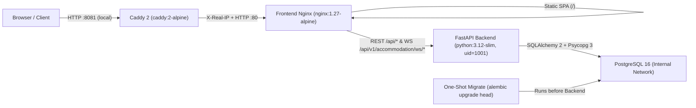
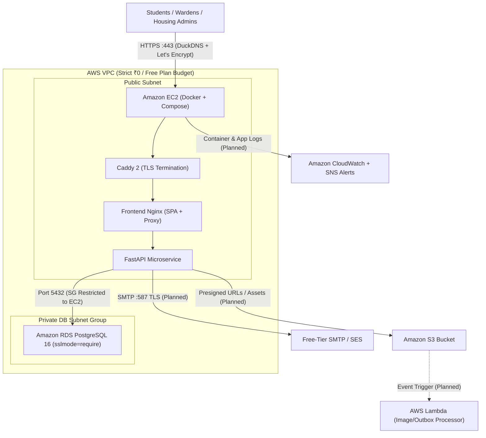

# Accommodation Microservice — Cloud Architecture & Deployment Guide

> **Verification Boundary:** Sections 1–4 describe **implemented and locally verified** components (`accommodation-ms` and `accommodation-prod-local`). Sections 5–7 describe **planned AWS cloud components** (not yet provisioned).

---

## 1. Current Verified Local & Production-Like Architecture

---

## 2. Proposed AWS Cloud Architecture (Planned — Not Yet Provisioned)

---

## 3. Production Container Topology & Network Boundaries
- **Public Exposure:** Only `caddy` publishes ports `80` and `443` (or `127.0.0.1:8081` in `prod-local`).
- **Internal Only:** `frontend` (`:80`), `backend` (`:8000`), and `db` (`:5432`, local override only) communicate strictly over `accommodation_prod_net`.
- **No Privileged Containers:** No `privileged: true` and no `/var/run/docker.sock` mounts.
- **Log Rotation:** All services use `json-file` with `max-size: "10m"`, `max-file: "3"`.

---

## 4. Database Migration, Health & Trusted Proxy Strategy
- **Controlled Migrations:** One-shot `migrate` service executes `alembic upgrade head` (`0001 -> 0002 -> 0003`) before `backend` starts, avoiding multi-worker race conditions. `seed.sql` / `app.seed` is never loaded in production.
- **RDS TLS:** Supports `DATABASE_URL` with `sslmode=verify-full&sslrootcert=/etc/ssl/certs/rds-ca-bundle.pem` or discrete `AWS_RDS_*` with `AWS_RDS_SSLMODE=require`.
- **Health vs. Readiness:**
  - `GET /api/v1/accommodation/health`: Lightweight process responsiveness check (`200`).
  - `GET /api/v1/accommodation/ready`: Verifies PostgreSQL connectivity and core tables (`accommodation_auth_accounts`, `bed_inventory`), returning `200` or `503` without leaking credentials or stack traces.
- **Trusted Proxy (`TRUST_PROXY_HEADERS`):** Caddy overwrites `X-Real-IP` with `{remote_host}`. Nginx forwards `$http_x_real_ip`. FastAPI `rate_limit.py` trusts `X-Real-IP` **only** when the direct TCP peer is an RFC1918/loopback proxy IP (`127.0.0.0/8`, `10.0.0.0/8`, `172.16.0.0/12`, `192.168.0.0/16`, `::1/128`, `fc00::/7`), blocking spoofed `X-Forwarded-For` headers from public clients.

---

## 5. Planned AWS Integrations (Steps 7+)
- **Amazon RDS PostgreSQL 16:** Private subnet deployment, automated backups, Security Group allowing `5432` only from EC2 SG.
- **Amazon S3:** Hostel photo storage replacing external Unsplash URLs in `mockData.ts`.
- **AWS Lambda:** Serverless event processing (e.g., S3 thumbnail/validation or `outbox_events` notifications).
- **CloudWatch & SNS:** EC2/Docker log shipping, `/ready` alarms, and SNS email/alerting.
- **GitHub Actions & Docker Hub:** Automated `pytest`, `oxlint`, `tsc`, `npm test`, image build/push with immutable tags, and SSH/SSM deployment to EC2.

---

## 6. Production Email (SMTP) Assessment (Strict ₹0 Budget)
1. **Brevo (formerly Sendinblue) Free Tier:** 300 emails/day free, no credit card required, supports SMTP (`smtp-relay.brevo.com:587` TLS) — **Recommended** for zero-cost academic OTP delivery after domain/sender verification.
2. **Gmail SMTP (App Password):** Free up to ~500 emails/day, requires 2FA + App Password on a Google account; suitable only for small personal demos.
3. **Amazon SES:** Free tier on EC2 (62,000 outbound emails/month if eligible), but starts in **SES Sandbox** (only verified recipient addresses) until AWS approves production access.
4. **EC2 Outbound Port Note:** AWS throttles port `25` by default; always use **port `587` (STARTTLS)** or `465` (SMTPS).

---

## 7. Resource Sizing Observations (Measured Locally)
- **Images:** `backend` (`348 MB`), `frontend` (`74.1 MB`), `caddy` (`92 MB`).
- **Idle Container Memory (Caddy + Nginx + FastAPI):** `~89.6 MiB` (`11.36 + 13.23 + 65.04 MiB`).
- **EC2 Sizing Note:** With external RDS, `~90 MiB` idle + OS + Docker daemon fits on `1 GiB` only with swap and tight headroom; **`2 GiB` RAM** is much safer for concurrent traffic and image pulls. Actual AWS Free plan eligibility and instance selection will be verified in Step 7.
